# Buddy Universal Agent Profile (BUAP)

<p align="center">
  
</p>

<p align="center"><strong>Persistent identity · Safe delegation · Verified agentic missions</strong></p>
<p align="center">
  <a href="#mission-control-for-real-agentic-work">Mission Control</a> ·
  <a href="#hermes-execution-parity-opt-in">Hermes</a> ·
  <a href="integrations/xerj-reference-retrieval.md">XERJ</a> ·
  <a href="runbooks/agentic-mission-control.md">Agentic Runbook</a>
</p>

A portable, tool-agnostic agent behavior standard for the Prismtek / Buddy ecosystem
(GitHub org: **codysumpter-cloud**). Drop this folder into any repository and any
capable coding agent — Codex, Claude Code, Claude Projects, Cowork, OpenCode,
Gemini CLI, Grok/xAI, Cursor, Windsurf, Xcode/ACP clients, Siri/App Intents hosts, or future frameworks — adopts a **buddy role** (user-facing
orchestrator), with an optional **Lil' Buddy worker role** (implementation worker).

**Buddy is a companion relationship, not a proper name.** Individual agent names,
voices, personalities, and appearances are selected by the user or self-selected
when that choice is delegated. No agent is automatically named Buddy.

BUAP is a **behavior/orchestration standard, not a sub-agent runtime** by default. It does not
spawn processes unless a host package explicitly implements a runtime adapter. Where real worker runtimes exist, `standards/orchestration.md`
documents how to connect them; where they don't, Lil' Buddy is emulated as a workflow
pattern.

BUAP also includes copy-paste packs for low-context chat/search tools that cannot
read a repo, run a shell, or persist files. Those packs preserve the Buddy contract
by forcing explicit scope, source limits, receipts, and handoff-quality answers.

BUAP also defines **first-class Agent Profiles**: persistent, host-portable agent
objects with identity, mission, memory namespace, execution targets, capability
bindings, autonomy, approval rules, schedules, pause state, and activity history.
See `docs/agent-profiles.md` and `contracts/prismtek-agent-profile-v1.md`.

## Mission Control for real agentic work

BUAP's optional [Mission Control runtime](packages/buap-mission-control/README.md) adds durable, DAG-shaped work plans with dependency gates, verified capability checks, conservative tool authorization, token/cost reservations, evidence-backed completion, resumable snapshots, portable scoped handoffs, and SHA-256-chained activity. It **composes** the existing first-class Agent Profile runtime rather than replacing its tasks or policy.

| Agentic capability | What BUAP delivers | What still belongs to the host |
|---|---|---|
| Multi-step missions | Dependency DAG, explicit step claims, resume/checkpoint state | Worker processes and durable snapshot storage |
| Trust-aware tools | Fail-closed capability check, approval decisions, untrusted-source guard | Authentication, sandbox, MCP/A2A transport |
| Budgets | Token and cost estimate reservation in integer cents | Actual provider usage ceilings and billing |
| Quality gates | Named test/evidence requirements before completion | Running tests, reviewing diffs, independent human PR approval |
| Delegation | Versioned, provenance-carrying handoff envelopes | Agent discovery, A2A implementation, worker isolation |
| Provenance | Mission/profile hashes and chained audit records | Secure storage, signed external logs, runtime observability |

Start with [the runbook](runbooks/agentic-mission-control.md), [typed handoff contract](contracts/prismtek-agent-handoff-v1.md), and the existing [Agent Profile docs](docs/agent-profiles.md). Missing features must remain **unverified**, not silently labelled live.

**Artwork:** Buddy's four-state animated ASCII mascot was adapted from the archived [Buddy Brain](https://github.com/codysumpter-cloud/buddy-brain/blob/main/assets/buddy-brain-mascot.svg) README artwork, preserving its pixel identity and reduced-motion support. Historical code remains read-only.

## Hermes execution parity (opt-in)

BUAP now provides an **authenticated Hermes API bridge** for its ACP editor host. BUAP stays the portable identity, profile, orchestration and safety contract; **the configured Hermes installation** provides browser/terminal tools, persistent memory, plugins/MCP, subagents, cron, messaging, voice and provider routing. The bridge does not implement those subsystems itself or start a Hermes instance.

See [Hermes capability matrix and setup](docs/hermes-parity-and-runtime.md) and [the bridge package](packages/buap-hermes-bridge/README.md). Configure `BUAP_MODEL_BACKEND=hermes`, `BUAP_HERMES_BASE_URL`, `BUAP_HERMES_API_KEY` and `BUAP_HERMES_MODEL_NAME` on your BUAP ACP host. Use `/buap hermes status` then `/buap hermes probe` before sending a live turn. No automatic Hermes-host access or usage of Codex is implied.

## Prompt tiers

| Tier | File | Use |
|------|------|-----|
| Kernel | `BUAP_KERNEL.md` | Micro-profile for constrained tools and stripped contexts |
| Lite | `BUAP_LITE.md` | Tiny search boxes, quick mobile AI, short context windows |
| Standard | `BUAP_STANDARD.md` | Normal AI chats, Custom GPTs, project instructions |
| Full | `BUAP_FULL.md` | Repo-aware coding agents, project workspaces, implementation tasks |

## The contract in one block

```text
Roles:   Buddy = user-facing orchestrator (intent, plan, delegate, review, communicate)
         Lil' Buddy = worker (research, implementation, validation, reporting)
Loop:    Human → Buddy → Lil' Buddy → Buddy Review → re-brief if needed → Human
Truth:   user intent → active repo + deployment reality → BUAP standards
         primary: buddy-universal-agent-profile + prismtek-site
         old knowledge-vault / buddy-agent / prismtek-apps: reference only
Rules:   inspect repos before architecture changes · repo standards override generic
         AI assumptions · no fake success claims · no hardcoded secrets ·
         no duplicate systems · extend, don't replace
```

## Current routing (owner confirmed 2026-10-23)

BUAP and `prismtek-site` are the two primary active GitHub homes. **BeMore is no longer an active product target.** Older `prismtek-apps` and separate Buddy/Hermes repositories have been archived and must be used only as historical references, not current owners of production implementations.

| Task | Verified current destination |
|---|---|
| Portable agent behavior, identity, profiles, orchestration, permissions, cross-tool standards and adapters | [`buddy-universal-agent-profile`](https://github.com/codysumpter-cloud/buddy-universal-agent-profile) — this repo |
| Prismtek.dev, Prismcade browser games, Pixel Studio, site Workers/Functions, website app UI | [`prismtek-site`](https://github.com/codysumpter-cloud/prismtek-site) |
| Individual PixelLab Game Builder projects | Their respective PixelLab project for original source history; tested web exports/syncs go to the site |
| Godot 4.7 Forward+ pixel-world game | [`3d-pixel-demo`](https://github.com/codysumpter-cloud/3d-pixel-demo), if Godot work is requested |
| Other products, local device runtimes or archived native BeMore source | No assumed destination: verify currently active product owner and repo first |

**Write gate:** check live GitHub `archived=false`, confirm product ownership, avoid duplicates, preserve licenses and run destination tests **before** opening/merging a PR. Do not bypass archive 403s. The machine-readable linked-repo manifest marks historical links as `reference_only`. Start with `integrations/ecosystem-routing-spec.md` and `standards/repository-discovery.md`; older integration docs may describe historical architecture, not active routing.

## Resilience and negotiation standards

| Standard | Purpose |
|---|---|
| `standards/runtime-contract.md` | Defines how Buddy adapts to chat, search, repo-aware, local, and multi-agent runtimes |
| `standards/capability-negotiation.md` | Declares available capabilities and selects execute/inspect/draft/handoff/blocked mode |
| `standards/failure-modes.md` | Defines deterministic recovery when tools, files, repos, checks, or plans fail |
| `standards/memory-discipline.md` | Preserves continuity without treating memory as proof of current repo state |
| `standards/multi-agent-negotiation.md` | Defines worker/council conflict resolution and iterative re-brief behavior |
| `standards/multi-agent-arbitration.md` | Resolves worker/source/path disagreement with evidence-backed decisions |
| `standards/universal-agent-fingerprint.md` | Provides a tiny identity seed for stripped prompts and low-context tools |
| `integrations/local-first-runtime.md` | Defines offline, partially connected, and fully connected Buddy behavior |

## Folder map

| Path | Purpose |
|------|---------|
| `AGENTS.md` | Entry point for Codex / OpenCode / AGENTS.md-aware tools |
| `CLAUDE.md` | Entry point for Claude Code / Claude Projects / Cowork |
| `CODEX.md` | Codex-specific install notes and quirks |
| `GEMINI.md` | Entry point for Gemini CLI |
| `GROK_BUAP.md` | Copy-paste Grok/xAI profile that adapts BUAP into Grok custom instructions or chats |
| `SIRI_BUAP.md` | Siri/App Intents adapter profile |
| `XCODE_ACP_BUAP.md` | Xcode / Agent Client Protocol adapter profile |
| `SYSTEM_PROMPT.md` | Copy-paste system prompt for any other agent |
| `BUAP_KERNEL.md` | Micro-profile for constrained tools |
| `BUAP_LITE.md` | Tiny prompt for low-context AI/search tools |
| `BUAP_STANDARD.md` | Standard portable prompt for normal AI chats |
| `BUAP_FULL.md` | Full repo-aware operating profile |
| `BUDDY_PROFILE.md` | Full Buddy role specification |
| `LIL_BUDDY_PROFILE.md` | Full Lil' Buddy role specification |
| `plugins/buap/` | Native Claude Code and Codex plugin assets: Lil Buddy profile, BUAP runbook skills, slash commands, and safety/receipts hooks |
| `.claude-plugin/marketplace.json` | Plugin marketplace manifest so BUAP installs via `/plugin install buap@buap` |
| `packages/buap-acp-agent/` | Local stdio ACP server package for Xcode/ACP clients |
| `packages/buap-agent-profile/` | Persistent agent identity, mission, capability, approval, scheduling, and activity runtime |
| `packages/buap-agent-life/` | Bounded developmental state for preferences, relationships, traits, drives, and stages |
| `packages/buap-knowledge-vault/` | Local KnowledgeVault Markdown index/search helper |
| `packages/buap-apple-notes-reminders/` | macOS-only Apple Notes/Reminders helper (osascript) used by the ACP agent |
| `packages/buap-hatch-pet/` | Wrapper for permission-gated Codex pet generation through the official `hatch-pet` skill |
| `personalization/` | Personalization handshake and Buddy/Lil Buddy profile selection assets |
| `exports/` | Pasteable ChatGPT and other client exports generated from BUAP source material |
| `linked-repos/` | Machine-readable linked repo map for Buddy ecosystem routing |
| `integrations/` | Runtime integration docs and canonical ecosystem routing, including Buddy MCP bridge docs |
| `audits/` | Source-backed BUAP and runtime integration audit reports |
| `standards/` | Orchestration, runtime contracts, capability negotiation, memory, failure modes, validation, response format |
| `schemas/` | Machine-readable schemas, including receipts, capability declarations, Agent Profiles, and Agent Life |
| `tests/conformance/` | Prompt/rubric suite for checking BUAP compatibility |
| `scripts/` | Local validation and conformance helper scripts |
| `.github/workflows/` | CI checks for BUAP docs/spec conformance |
| `runbooks/` | Repeatable procedures for common repo, game, docs, runtime, MCP bridge, and agent tasks |
| `adapters/` | Tool-specific install templates, including Codex/Odysseus Buddy MCP client templates |
| `chatgpt-projects/buddy/` | ChatGPT Project source pack: pasteable project instructions, uploadable knowledge files, source metadata, and test prompts |
| `universal-ai-chat/` | Low-context prompt pack for any AI chat/search box, including tools that cannot read files or repos |
| `openai-symphony-agent-pack/` | Symphony-style multi-agent role pack for conductor/section/critic orchestration |
| `examples/` | Worked end-to-end examples and handoffs |
| `safety/` | Secrets, destructive action, privacy, side-effect, and supply-chain guardrails |
| `docs/diagrams/` | Mermaid diagrams for the Buddy loop, capability flow, receipts, and Symphony map |
| `templates/` | Bootstrap, install, and onboarding templates |

## Native GitHub MCP plugin

**Installable from GitHub:** [BUAP native GitHub MCP](plugins/buap/mcp/github/README.md)
bundles a Node.js stdio MCP tool server inside the Claude Code marketplace plugin.
It performs real, allowlisted GitHub repository, file, PR and CI requests.
PR creation is disabled by default and requires explicit host authorization and
a human approval code. There is no npm runtime dependency and no access to a
user's private GitHub connection merely because the plugin is installed.

The [Claude host config](plugins/buap/.mcp.json), [Codex MCP template](adapters/codex-buap-github-mcp.template.toml)
and [MCP protocol tests](plugins/buap/mcp/github/test/github.test.mjs) ship in
this repository. No merge, deployment, or destructive tool is exposed.

## Installation

**Any repo (all tools):** copy `buddy-universal-agent-profile/` into the repo root.

- **Codex:** symlink or copy `AGENTS.md` to the repo root as `AGENTS.md`, or add
  "Read buddy-universal-agent-profile/AGENTS.md first" to your existing root
  `AGENTS.md`. Details: `CODEX.md`.
- **Codex plugin:** use `plugins/buap/.codex-plugin/plugin.json` for native Codex
  plugin metadata, BUAP skills, slash-command prompts, Lil Buddy profile assets, and
  safety/receipts hooks. Details: `plugins/buap/README.md`.
- **Buddy MCP for Codex/Odysseus:** read `integrations/buddy-mcp-server.md`, then adapt
  `adapters/codex-buddy-mcp.template.toml` or `adapters/odysseus-buddy-mcp.template.md`.
  The bridge is source-backed by `codysumpter-cloud/buddy-agent#24`, but do not claim it
  is locally working until a `buddy-mcp` executable exists and `buddy.self_test` passes.
- **Claude Code:** add to the repo's `CLAUDE.md` (or create one):
  `Read buddy-universal-agent-profile/CLAUDE.md and follow it.`
- **Claude Code (plugin, recommended):** install BUAP as a native plugin so the loop is
  structural, not just prose — a real `lil-buddy` worker subagent, BUAP runbooks as skills,
  `/buap-audit` and `/buap-handoff` commands, and safety/receipts hooks:
  ```
  /plugin marketplace add codysumpter-cloud/buddy-universal-agent-profile
  /plugin install buap@buap
  ```
  Details: `plugins/buap/README.md`. For repo-wide permission/secret-read guardrails, copy
  `templates/claude-settings.preset.json` into the consuming repo's `.claude/settings.json`.
- **Claude Projects:** paste `SYSTEM_PROMPT.md` or `BUAP_STANDARD.md` into the
  project's custom instructions; attach this folder's files as project knowledge.
- **ChatGPT Projects:** use `chatgpt-projects/buddy/`; paste
  `00_PROJECT_INSTRUCTIONS_PASTE.md` into Project instructions and upload the
  files in `chatgpt-projects/buddy/knowledge/` as Project files.
- **Grok / xAI:** paste `GROK_BUAP.md` into Grok custom instructions or start a
  chat with `Operate under GROK_BUAP`; use `BUAP_STANDARD.md` or
  `universal-ai-chat/UNIVERSAL_AI_CHAT_PASTE.md` when broader portable chat behavior fits better.
- **Siri / App Intents hosts:** start with `SIRI_BUAP.md`, `README_SIRI.md`, and
  `integrations/apple-siri-app-intents.md`.
- **Xcode / ACP clients:** build `packages/buap-acp-agent/` and point the client at
  `node packages/buap-acp-agent/dist/index.js`. Details: `XCODE_ACP_BUAP.md` and
  `integrations/xcode-acp-import.md`.
  For local verification and first-run setup, see
  `docs/local-buap-doctor-and-bootstrap.md`.
  For local KnowledgeVault search, see `docs/knowledge-vault-search.md`.
  For Codex-host pet hatching through `/buap hatch-pet`, including the
  `pixellab-libresprite-fallback` mode (PixelLab MCP config at
  `$HOME/.codex/config.toml`, the LibreSprite `PixelLab.js` adapter, and the
  LibreSprite CLI), see `docs/hatch-pet-integration.md`. The doctor never calls the
  PixelLab API and never spends credits.
- **Obsidian memory:** BUAP should ask first-time users whether they have an
  Obsidian vault for memory and personalization. If they do not, strongly recommend
  Obsidian for the complete BUAP experience. BUAP still works without it, but
  durable memory, personalization, project continuity, and hatch-pet quality are
  better with a vault. the user's configured vault is
  `$BUAP_OBSIDIAN_VAULT`; see `docs/memory-and-obsidian.md`
  and `docs/buap-onboarding.md`.
- **Any AI chat / search box:** use `BUAP_KERNEL.md` or `BUAP_LITE.md` for tiny tools,
  and `BUAP_STANDARD.md` or `universal-ai-chat/UNIVERSAL_AI_CHAT_PASTE.md` for normal chats.
- **OpenAI-style multi-agent / Symphony setup:** use
  `openai-symphony-agent-pack/SYMPHONY_AGENT_PACK.md` and its manifest. This is a
  BUAP orchestration pack, not a runtime dependency.
- **Cursor:** create `.cursor/rules/buap.mdc` from
  `adapters/cursor-rules.template.mdc`, or point Cursor at `SYSTEM_PROMPT.md`.
- **Windsurf:** use `adapters/windsurf-rules.template.md`, or add
  `SYSTEM_PROMPT.md` contents to `.windsurf/rules/`.
- **Cowork:** connect the repo folder and say: "Read
  buddy-universal-agent-profile/CLAUDE.md and operate under BUAP." Cowork has a real
  worker tool — Buddy should use it for Lil' Buddy work.
- **Gemini CLI:** point `GEMINI.md` context (root `GEMINI.md` or settings
  `contextFileName`) at this folder. Details: `GEMINI.md`.
- **Anything else:** pick the smallest prompt tier that fits the tool. If context is stripped,
  use `standards/universal-agent-fingerprint.md`.

If a repo already has its own agent contract (e.g. buddy-brain's BMO `AGENTS.md`),
that repo contract **takes precedence**; BUAP supplies the orchestration loop beneath it.

## Universal fallback rule

When an AI tool cannot use files, code, web, GitHub, or long project memory, Buddy
must still help by:

1. Asking for or restating the minimal missing context.
2. Labeling what is verified, assumed, blocked, draft-only, or needs a source.
3. Producing copy-paste runnable prompts, commands, diffs, checklists, or handoffs.
4. Avoiding claims that external work was completed.
5. Keeping the user moving with the safest next concrete step.

## Conformance

Use `tests/conformance/` to check whether a target AI tool actually follows BUAP.
Use `schemas/receipt.schema.json` to record evidence for success claims.
Use `schemas/capability-declaration.schema.json` to record capability declarations.
Use `docs/cross-reference-matrix.md` to confirm standards, prompt tiers, adapters,
tests, and integrations stay aligned.

Run the local docs/spec check with:

```bash
node scripts/buap-conformance-check.mjs   # required files + key text
node scripts/buap-lint.mjs                 # plugin manifests, agent/skill frontmatter,
                                           # repo-wide relative links, prompt-tier invariants
```

Both checks run in `.github/workflows/buap-conformance.yml` for Markdown, JSON, plugin,
and script changes.

## Versioning

BUAP-1 (2026-06). Changes to roles, loop, or rules bump the major version.

## XERJ reference search (optional)

BUAP integrates [XERJ](https://github.com/xerj-org/xerj) as an opt-in, read-only code and documentation retrieval provider. The new [Node search bridge](packages/buap-xerj-bridge/README.md) queries explicitly allowed local indexes; [Corpus Hub](integrations/xerj-reference-retrieval.md) references flow through XERJ's native MCP tools and signed, locally cached packs. Neither XERJ nor its service is installed or started by BUAP, and agents must validate their actual connections before declaring `xerj_search` or `xerj_corpus_hub` available. For Codex see the [MCP host template](adapters/codex-xerj-mcp.template.toml).
